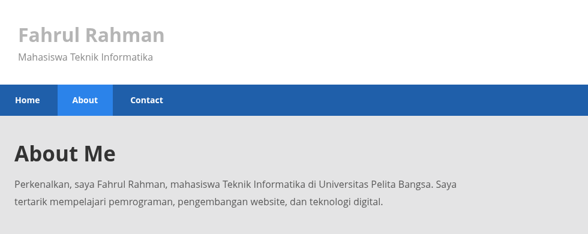
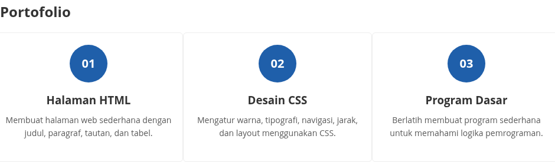
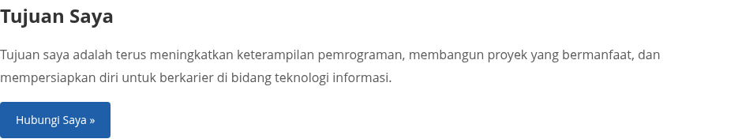
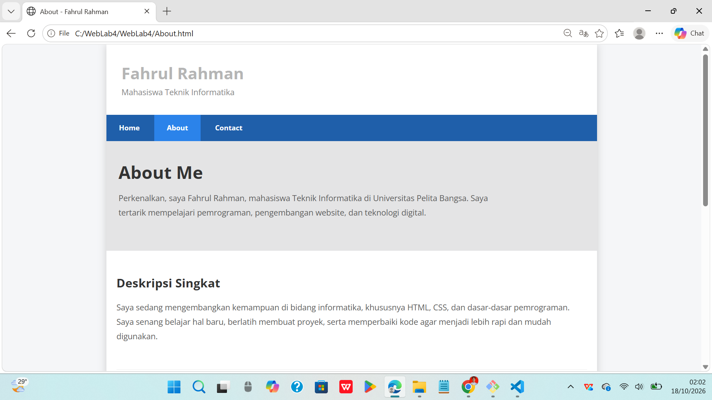
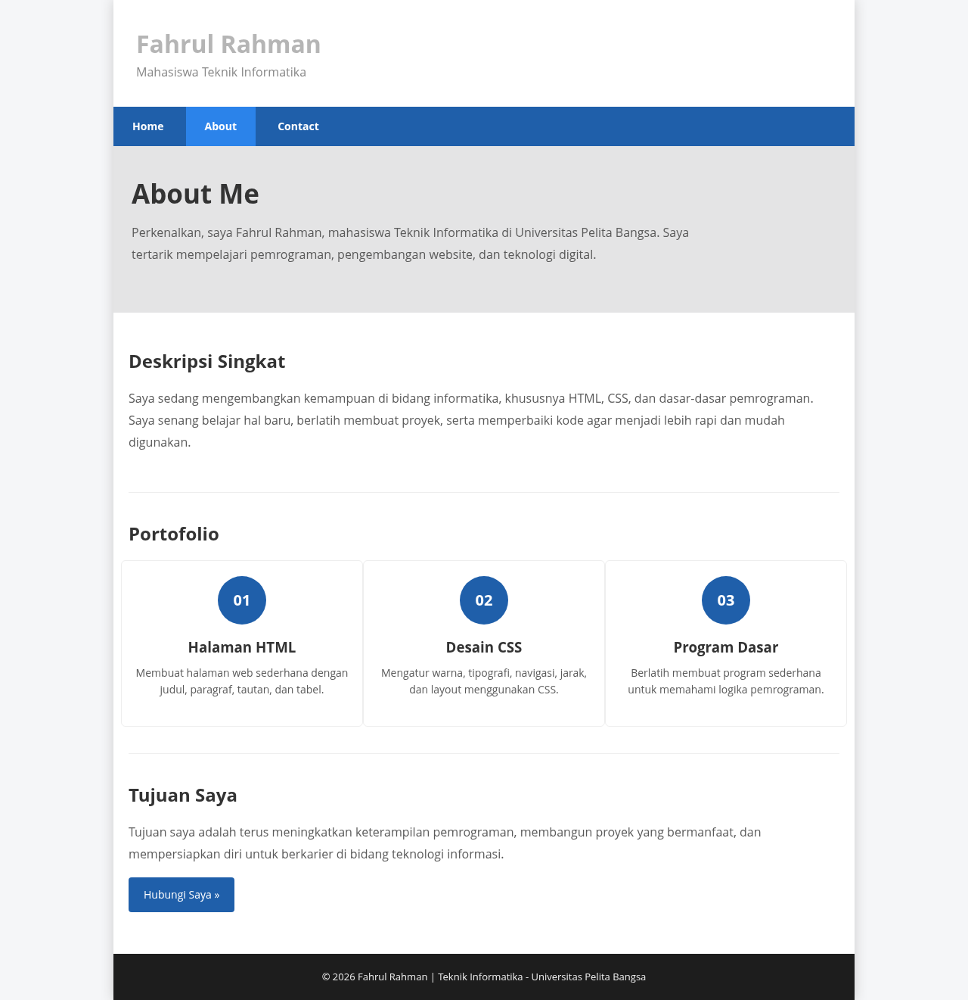

# WebLab4

## Nama: Fahrul Rahman

## Nim: 312510088

## Teknik Informatika

### 1. Tambahkan Layout untuk menu About

Penjelasan

- Header
  Bagian header berfungsi menampilkan identitas pemilik website, yaitu Fahrul Rahman sebagai mahasiswa Teknik Informatika. Elemen <h1> digunakan untuk menampilkan nama, sedangkan 
 digunakan untuk menampilkan keterangan atau deskripsi singkat.
- Navigasi
  Navigasi digunakan untuk memudahkan pengunjung berpindah dari satu halaman ke halaman lainnya. Menu Home menuju halaman utama, About menuju halaman profil, dan Contact menuju halaman kontak. Class active menandakan bahwa halaman About sedang dibuka.
- Hero About Me
  Bagian hero merupakan area pengenalan utama pada halaman About. Bagian ini berisi judul About Me dan informasi singkat mengenai pemilik website, termasuk jurusan kuliah serta minat dalam pemrograman dan teknologi digital.
- Deskripsi Singkat
  Bagian ini menjelaskan kemampuan dan kegiatan belajar pemilik website. Elemen Article digunakan untuk mengelompokkan konten yang berdiri sebagai sebuah bagian informasi, sedangkan H2 menjadi judul dan P berisi penjelasan.
- Portofolio
  Bagian portofolio menampilkan contoh proyek atau keterampilan yang sedang dipelajari. Terdapat tiga kategori utama:

1. Halaman HTML: mempelajari struktur halaman website, paragraf, tautan, dan tabel.
2. Desain CSS: mempelajari pengaturan warna, tipografi, navigasi, dan tata letak.
3. Program Dasar: mempelajari logika pemrograman melalui program sederhana.
   Class row digunakan untuk mengelompokkan kartu, sedangkan class box portfolio-card mengatur tampilan setiap kartu portofolio menggunakan CSS.
